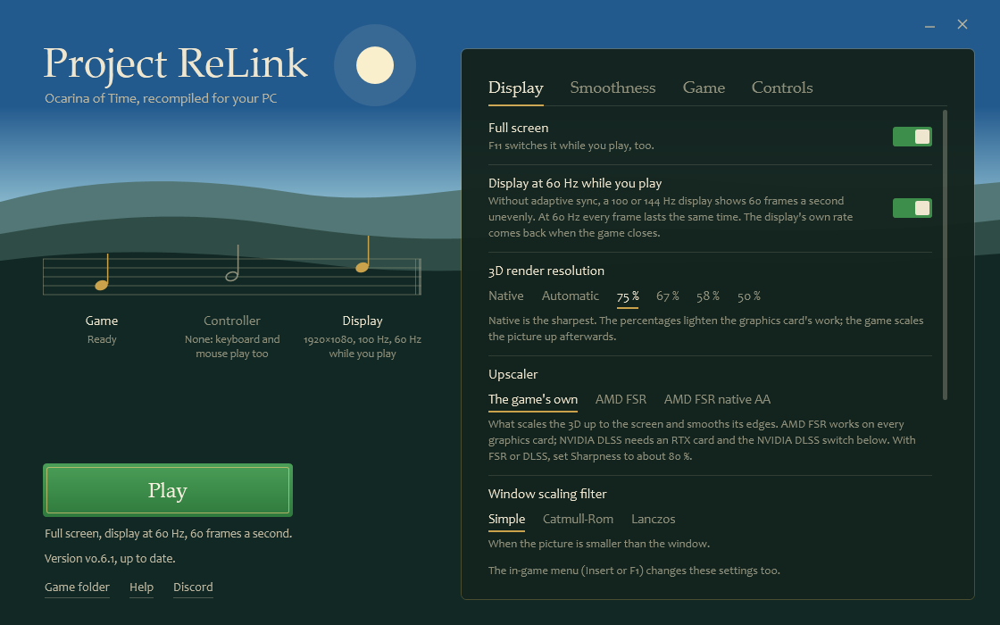
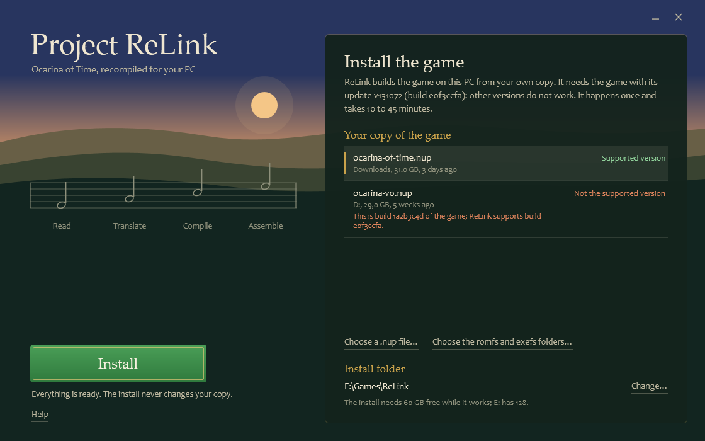
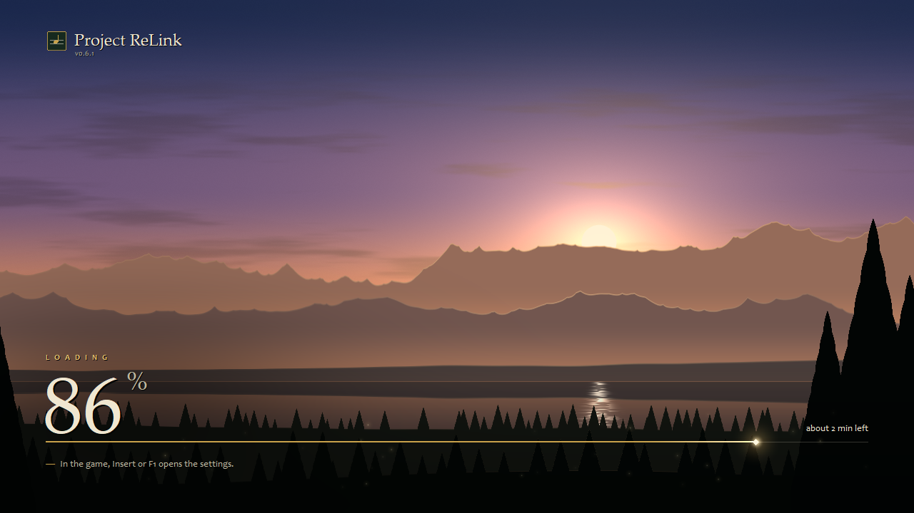

# Project ReLink

<a href="https://recomplauncher.com"><picture><source media="(prefers-color-scheme: dark)" srcset="https://recomplauncher.com/assets/press/launcher/badge-light.svg"></picture></a>

**Zelda OOT Remake Recomp.** An unofficial static recompilation of *The Legend of Zelda: Ocarina of Time* (the Switch 2
remake) into a native Windows game: the game's code is translated to PC code and compiled on your machine, with no emulator.

[Français plus bas](#français)

**Discord:** [join the Project ReLink server](https://discord.gg/RFNUtCQk8j) to ask questions, get help and follow new
versions. Bugs are still best reported as [issues](https://github.com/pixl27/ProjectReLink/issues) with `relink_log.txt`
attached, so they don't get lost.



**No game files are in this repository.** ReLink builds the game on your PC from your own copy.

## The game version you need

ReLink works with **one version of the game**: the Switch 2 remake with its update installed.

| | |
|---|---|
| Program | `0400486024DEC000` |
| Update | v131072 |
| Build | `e0f3ccfa` |

Other versions do not work: the launcher checks your copy and says so before it installs anything. Your copy is either a
`.nup` file, or the game's `romfs` and `exefs` folders.

## Install and play

1. Download `ReLink-Setup.exe` from the [latest release](https://github.com/pixl27/ProjectReLink/releases/latest).
2. Run it. It downloads ReLink and its tools (about 310 MB), checks them and opens the launcher. Nothing else to install:
   ReLink brings its own compiler and Python.
3. Pick your copy of the game. The launcher looks for `.nup` files in Downloads, Desktop and Documents; you can also choose
   one, drop it on the window, or give the `romfs` and `exefs` folders.
4. Press **Install**. It takes 10 to 45 minutes depending on your CPU; you can keep using the PC.
5. Press **Play**. The desktop and Start menu shortcuts open the launcher from then on.

**With RecompLauncher.** Each release also has `ProjectReLink-<version>-Windows-x64.zip`, the same tools in one file, with a
`recomplauncher.json` that lets [RecompLauncher](https://recomplauncher.com) install ReLink, ask for your copy (the same
version as above), build the game in the same way and start it. Its settings page writes the game's own
`relink_options.ini`; the frame rate goes in `relink_env.txt` beside it.

The first start is long, once (about 16 minutes on our PC): the game prepares its shaders, builds its graphics pipelines
for your driver's cache and makes the compute pipelines play is known to use, with a progress screen. It does that part
again after a graphics driver update, so that the first visit of a place does not stutter while the driver compiles, and
after an update of ReLink that changes the renderer's shader code or state (0.6.3 is one). Since 0.7.6 every PC starts the
same way, whatever its RAM. A PC that ran an earlier version with 20 GB of RAM or more has a pipeline cache file in the game
folder, `mkw_vk_pipelines.bin` (800 MB and more), that nothing reads any more: since 0.7.8 the game deletes it at its first
start, unless `RX_VK_LEAN_PIPELINES=0` in `relink_env.txt` brings back the older start, which uses it.





### What your PC needs

- 64-bit Windows 10 or 11, and a CPU with AVX2.
- A graphics card with Vulkan 1.3 and mesh shaders, with an up-to-date driver: NVIDIA GeForce RTX 20 series or newer, AMD
  Radeon RX 6000 series or newer, Intel Arc. We only tested on NVIDIA. Since 0.7.9 a card without mesh shaders (GeForce GTX
  10 series) gets a picture too, as an experiment: about half the frame rate, and some large rocks missing.
- 8 GB of video memory recommended, 16 GB of RAM or more.
- About 60 GB free while it installs, and an internet connection for the download.

### Updating

The launcher says when a new release is out. **Update** downloads only what changed and builds the game again in the same
folder, from the game files the folder keeps: your `.nup` is not needed again. Saves (`user`), settings and mods are kept.

### Where the files go

- The game: the folder you choose (`Games\ReLink` in your user folder by default). Your copy is never changed.
- ReLink itself: `%LOCALAPPDATA%\ReLink`. The build files (about 4 GB) are deleted once the game is ready.
- To uninstall: delete the game folder, `%LOCALAPPDATA%\ReLink` and the shortcuts.

## Settings

The launcher sets the display (full screen, 3D render resolution, upscaling, sharpness, ultrawide), the smoothness (60
frames a second or unlocked, frame generation), the game's language and the controls. It can put the display at 60 Hz while
you play, so that every frame lasts the same time on a 100 or 144 Hz display, and puts the display's own rate back
afterwards. In the game, **Insert** or **F1** opens the same menu, **F11** switches full screen, and **F12** saves a
screenshot: the game's picture at its output resolution, without the menu or the FPS counter, as a PNG in the game folder's
`screenshots` folder (a line over the game says where). These three keys can be changed in the menu's Gameplay tab
(**Menu key**, **Screenshot key**, **Fullscreen key**: F1 to F12, Insert, Pause or Scroll Lock).

**Upscaler** (since 0.7): what scales the 3D up to the screen. The game's own network by default; **AMD FSR 4**, AMD's network,
on a Radeon RX 6000 or newer with a recent driver, and **AMD FSR 3.1** on any graphics card (AMD's DLLs come with ReLink; the
**FSR version** row chooses between them); or **NVIDIA DLSS / DLAA** on an RTX card, after turning on **NVIDIA DLSS** on
the launcher's Display page: that builds the game again with NVIDIA's DLSS SDK, downloaded from NVIDIA under NVIDIA's license.
With FSR or DLSS, set Sharpness to about 80 %. The frame rates below are measured without them.

The launcher is in English; French is one click away on its Game page. An Xbox controller or any XInput controller works,
and so do keyboard and mouse (the keys are listed on the Controls page). Since 0.6.2 the install also brings SDL, which the
game uses for the other controllers (Switch Pro, DualSense, DualShock 4): 0.6.1 shipped without it and they did nothing in
the game. We have none of them here, so that part is not tested by us.

The mouse turns the camera after a click in the game's window (Escape frees it). The Insert menu's **Mouse camera** row
chooses how: as the right stick, or "Native", one to one as in a PC game. If the game has no sound, the same menu's
**Audio output** row (Gameplay) can be set to Stereo; it applies after a restart. The **Volume** row just above it sets the
game's whole sound, music, effects and voices, from 0% (muted) to 100%, heard at once and kept in relink_options.ini.

**Item wheel** (Gameplay, off by default): holding R or L shows the item row as a wheel, Twilight Princess style. Point at an
item with either stick (or the mouse) and let go: it is on ZR at once. The items are on pages of 8 slots, one set for child
Link and one for adult Link; Left and Right (or the mouse wheel) turn the page, Y takes an item up to put it in another slot,
B puts it back. The pages are kept in `wheel_layout.txt` beside `relink_options.ini`. The wheel shows the game's own icons,
names (in the game's language) and sounds, which every build takes from your game files into the `wheel` folder.
**Cycle items** (Gameplay, off by default): a tap of R or L changes the item on ZR without opening the row: Last used
swaps with the item that was on ZR before, whatever it is; Basic puts the next or the previous arrow, bottle or spell on
ZR; +Bombs the bombs too; +Tools the hookshot, hammer, slingshot and boomerang too. Holding R or L still opens the row
(or the wheel), a quarter of a second later than without it.
`HOS_ITEM_WHEEL=0` or `1` and `HOS_CYCLE_ITEMS=0` to `4` in `relink_env.txt` stand
in for the two rows.

**30, smooth** (launcher, Smoothness tab, Frames per second): for PCs that do not hold 60. Every frame stays on screen for
the same number of refreshes (2 on a 60 or 120 Hz display), with vsync, and the game waits for the display before it starts
the next frame, so the 30 frames are even instead of swinging between 16 and 50 ms. Game time follows the clock. On a 144 Hz
display each frame is held 5 refreshes (28.8 fps). `HOS_FPS_CAP=<20-59>` in `relink_env.txt` sets another cap the same way.

**Field of view** (Insert menu, Graphics, 70 to 150 %): the camera's angle in percent of the game's own; the culling follows
it. `HOS_FOV=<percent>` in `relink_env.txt` stands in for the row.

**Left / Right stick dead zone** (Insert menu, Controls, 0 to 50 %, 24 by default, as before): raise it if Link walks or the
camera turns on its own (stick drift). The dead zone is round now (a diagonal push near the centre is no longer cut on one
axis) and what is past it starts just past the game's own dead zone. `HOS_STICK_DEADZONE_L` / `_R=<percent>` stand in for
the rows.

**ReShade and RenoDX**: ReLink renders through Vulkan, so ReShade must be installed with its Vulkan API and add-on support for
`relink-game.exe` (in the game folder's `bin`). When ReShade's layer is loaded the game keeps its presents on the graphics queue
and makes the swapchain's images drawable, which ReShade's effects and RenoDX's HDR output need (`RX_VK_RESHADE=1` forces this,
`0` turns it off). A RenoDX mod for this game still has to be written for its shaders: ReLink only removes what stopped
ReShade from drawing.

**HDR** (Insert menu, Graphics, applies after a restart): the game draws its own HDR picture, as it does on an HDR TV,
and ReLink shows it in HDR10. It needs Windows' HDR on for that display (Settings, System, Display, Use HDR); otherwise the
picture stays SDR. The game is told the display's peak brightness as Windows reports it; the interface and menus are at the
paper white, 203 nits by default (`hdr_paper_white=<80 to 500>` in `relink_options.ini`). Leave this row off when a RenoDX
mod does the HDR.

**Travel** (on the Cheats page: the Gameplay tab's **Cheats** row, shown unless `HOS_OOT_CHEATS=0` in `relink_env.txt` hides it, and
Travel is that page's last row): a page of 190 places to go to, villages, dungeons' entrances, shops, warp points and story spots,
grouped by area, for Link's age (Tab or X shows the other age's: going there makes Link that age). Once you have opened the
page, each place gets a picture taken from your own game the first time Link stays there a few seconds with the menu closed
(in `teleport_pictures` in the game folder); Y or Backspace on the page takes a place's picture
again at the next stay there. Link arrives through the game's own map change, as when he walks in. The places' positions
and arrival events come from your game files at every build (`teleport_places.bin`, `nx2/teleport_places.py`).

**Button prompts** (Controls, Nintendo by default): the buttons the game's prompts show, Nintendo's, Xbox's (A, B, X, Y, LB,
RB, LT, RT, Menu, View) or PlayStation's (cross, circle, square, triangle, L1, R1, L2, R2, Options, Create). Each prompt
shows the button that presses it, so the letters follow the **Layout preset** and your own bindings: with the Nintendo
preset, the Switch's A is the right-hand button and shows Xbox's B. The labels are ReLink's own drawings, which every build
adds to a copy of your game's button font in the `prompts` folder. The three faded letters around the HUD's action
button, which are pictures and not letters of the font, follow too: the renderer puts ReLink's own labels in their place
(`prompts\keytex.bin`, made by every build), and so do the ocarina's note buttons (A, B, X, Y, L and R, pictures as well:
`prompts\ocarina.bin`, made by every build from your game's own six, with the Switch's letter taken out and ReLink's label
drawn in its place). It applies the next time the game starts. The font has one colour, so the prompts are not coloured.
A mod that replaces the button font wins over this row, and the faded letters and the ocarina's notes then stay the
Switch's too.
`HOS_BUTTON_PROMPTS=0`, `xbox` or `playstation` in `relink_env.txt` stands in for it.

## Measured frame rates

On our PC: **Ryzen 5 5500, GeForce RTX 3060 Ti (8 GB), 16 GB of RAM, Windows 11**.

**No DLSS, no frame generation.** Every number here counts frames the game really rendered: no AI upscaler and no
generated frames were on. The game was capped at 60 frames a second; version 0.6.1, built by the release's own tools as
on a player's PC. "Native" is the game's 3D render resolution at 100 %; at 75 % the game's own plain scaling fills the
window. Each figure is one run of about 50 seconds with child Link, from his arrival in the place and through a walk, so
it includes the loading stall of the arrival.

| Place | Native (100 %) | 75 % |
|---|---|---|
| Hyrule Field | 59.6 | 59.9 |
| Kakariko Village | 59.0 | 59.0 |
| Hyrule Castle | 58.2 | 59.2 |
| Lost Woods | 58.5 | 59.6 |
| Sacred Forest Meadow | 60.0 | 60.0 |
| Lake Hylia | 58.0 | 58.7 |
| Zora's Fountain | 56.7 | 58.4 |
| Market | 54.0 | 55.6 |
| Inside the Deku Tree | 59.8 | 59.9 |
| Dodongo's Cavern | 60.0 | 59.9 |
| Inside Jabu-Jabu's Belly | 59.9 | 59.9 |
| Bottom of the Well | 60.0 | 60.0 |

At native resolution the heaviest views of Kokiri Forest's village run at 55 to 56. With adult Link at 75 %, standing, an
earlier development build of this version gave 60 in Kakariko Village, the Fire Temple and Gerudo's Fortress and 58.0 in
the Water Temple; those four were not measured again on the release's build.

Version 0.6.2 translates the game with a play profile made in 30 places, child and adult Link, temples included (0.6.1's
came from 10, child only). The table above was not measured again with it. With the frame rate unlocked, at 75 %, in the
ten of these places whose walk has no loading screen, it gave about 3 % more frames while Link walks (four runs against
six of 0.6.1, the two versions run in turn: 69.0 to 71.1 against 66.1 to 69.1 as a geometric mean), most of it in the
dungeons (Inside the Deku Tree +11 %, Jabu-Jabu +5 to +8 %), and no difference we could establish with Link standing.

Version 0.6.3 gives the game's occlusion test its real answers. The game draws a box for each object in a depth-only
pass, asks the graphics card how many of its pixels passed, and leaves out of its next frames the objects that got none.
Until now every question was answered "visible", so nothing was ever left out. With the frame rate unlocked, at 75 %,
Link standing where he arrives, the same build run with the answers off and then on: Market 54.6 to 61.4 (+12.5 %), Lost
Woods 61.9 to 67.0 (+8.2 %), Kokiri Forest 76.1 to 79.4 (+4.4 %), and the most draws in a frame went from 2,931 to 2,494.
Two earlier pairs of runs gave the Market +12.3 % and +28.8 %, Lost Woods +7.0 %, Kokiri Forest +3.3 % and Hyrule Castle
no change. Kakariko Village gave +2.6 % and +13.8 %: that place varies by several frames from one run to the next, so
neither figure says much. The table above was not measured again. The pictures were compared standing in four places, and
turning and walking in the Market and inside the Deku Tree: nothing was missing. An object that appears one frame late
was not looked for frame by frame; `RX_VK_OCC_QUERIES=0` in `relink_env.txt` beside the game turns the real answers off.

Version 0.6.5 targets the stutter while the camera turns. Turning brings new things into view and lets others go, and the
renderer let go of each texture's image on its render thread, as it presented: on NVIDIA's Windows driver that is a call
into the system of a millisecond or more, and it was the largest thing the long frames did more of than the others. It is
now done on a thread of its own. Camera turned left, right and left for 20 s in the Market, 60 fps cap, 75 %: frames
over 25 ms went from 71 and 81 (two runs of 0.6.4) to 67, 50 and 66 (three runs of 0.6.5), the 99th percentile from
36-39 ms to 34-35 ms, the longest frame from 63-70 ms to 53-66 ms. Hyrule Field and Kokiri Forest had few long frames
before and still do. It does not remove the longer stalls of a first visit, while the game loads an area and its
shaders are read from disk.

Version 0.6.6 goes on with it. A shader drawn for the first time in a session is read from the shader cache by background
threads, several at once, instead of on the thread that draws the frame (then on a PC with less than 20 GB of RAM, and on
every PC since 0.7.6, that is every scene shader), and the rest of the driver's cleanup (texture views, images the video-memory reshuffle moved, freed
buffers) left the render thread too. The same build with these changes off (`RX_VK_REAP=0`, `RX_VK_ASYNC_LOAD=0`) and on,
the Market twice per run, three runs per side taken in turn: frames over 25 ms while the camera turns 59.5 on average
against 47.0, the 99th percentile 38.1 ms against 32.6 (lower in all six pairs), the time lost in long frames at the
first arrival 1,915 ms against 1,590. Against 0.6.5 itself, the background reads alone measured about 10 % less time lost
at arrivals. The shaders are prepared again at the first start after this update, once.

Not reached or not measured yet: a steady 60 everywhere (the Market stays below, and so do a few places at native
resolution), boss fights, sessions longer than half an hour, and AMD and Intel cards.

## Black cliffs, blurry rocks, missing models, a slow adult Link: check your dump

Some dumps hold damaged texture files: their first kilobytes are zeros, as the dumper read them. Which files, and how
many, differs from one dump to another (ours has 3 of 20,667). The game cannot read such a file, and what it does then
depends on what the file was:

- a piece of an area's baked lighting (`RBake_Scene_...`): everything it lights is drawn **black** (a whole cliff side);
- a texture of a model: the model **never finishes loading**. Rocks and walls are missing and the smooth, blurry ground
  under them shows instead; and the game loads the model again and again for ever, which keeps more than one CPU core
  busy (the fairy fountains as an adult: frames lost everywhere).

Every install and update checks the dump and writes a small mod, `mods\00-dump-repair` in the game folder, that stands in
for the damaged files (since 0.7.2 for two files it knew by name; since 0.7.9 for every damaged texture it finds). A
stand-in is an intact relative of the same kind and size from your own files, under the damaged file's name: the same
piece of lighting of the other age (child for adult), or the nearest texture of the same family. It is a relative, not
the real texture: lighting from the other age can be a little off, and a piece whose relative has another layout stays
partly dark. `mods\00-dump-repair\README.txt` lists what was damaged, what stands in for it, and what has no stand-in.
Only a new dump of the game brings the real files back.

Two tools in this repository do it by hand, from your own files (nothing of the game is in them):

```powershell
python -I tools/dump_check.py "C:\Games\ReLink\romfs\Tex"
python -I tools/dump_repair.py "C:\Games\ReLink\romfs" "C:\Games\ReLink\mods\00-dump-repair"
```

The first counts the damaged files; the second writes the mod, and needs no rebuild: the game reads mods when it starts.
They need the `zstandard` package, which ReLink's own Python has
(`%LOCALAPPDATA%\ReLink\versions\<version>\ReLink\tools\python\python.exe`).

## Mods

RomFS mods go in `mods\<name>\romfs\...` in the game folder, with the same paths as the game's. The log
(`relink_log.txt`) names each mod it reads. A mod may sit deeper, as emulators keep them (`mods\contents\<title id>\<name>`),
a folder whose name starts with `-` or `_` is off, and when two mods have the same file the one whose path sorts last wins
(name them `01-...`, `02-...`).

Patches of the game's code go in `mods\<name>\exefs\`, in the two formats emulators read:

- `<build id>.ips`, IPS32 or IPS, applied to the module whose build id is the file's name (the game's `main` is
  `E0F3CCFAF50065AE4EA01EB5AEB13B1A45DA3348`);
- `*.pchtxt`, the text patches that name their module with `@nsobid-<build id>` (with `@flag offset_shift`, `@enabled`,
  `@disabled`, `@stop`, `@flag be`, comments, hex values and `"strings"`).

ReLink translates the game's code when it builds the game, so these patches are applied then, to a copy of the code before
it is translated: **after adding, changing or removing one, build the game again** (the launcher's first page says
*Exefs mods changed since the last build* and offers *Build again*; the game says it too at its start). Your own copy of the
game is never changed. `relink_exefs_mods.txt` in the game folder lists what the last build applied or left out, and why.

- Patches made for another version of the game (another build id) are left out, and so is a patch that writes outside the
  module's code and data. When two mods write different bytes at the same place, the one whose path sorts last wins.
- Not supported: replacement module files (a whole `main` or `subsdk` in `exefs`), and patches of `rtld`.
- Code a patch adds in unused space of the code ("code caves") is translated when the game's code branches to it (`b`,
  `bl`, conditional branches), or when a pointer in the data or an `adr`/`adrp` outside the game's own functions holds its
  address; code reached only through a pointer made some other way is not, and the build says so (*not translated* in
  `relink_exefs_mods.txt`).
- A patch changes the translated code, so one of ReLink's own fixes or options in the same function may not apply any more:
  the build says which (*warning* lines), and stops with a message naming the patch when it is in the way of the output
  resolution, which cannot be half applied. Where a patch changes one of the two game functions ReLink runs natively (its
  zstd decoding and its name searches), the native version is left out and the patched code runs; a patch of a system
  function ReLink provides itself (`nn::` services, the graphics driver) has no effect. The build lists both.

## Build from source

For developers. The launcher runs the same script, `nx2/make_game.py`.

```powershell
python -I nx2/make_game.py --nup "C:\path\your-game.nup" --out "C:\Games\ReLink" --language en-US
python -I nx2/make_game.py --romfs "C:\path\romfs" --exefs "C:\path\exefs" --out "C:\Games\ReLink" --language en-US
```

`--game <path>` takes either one (a `.nup`, or a folder holding `exefs` and `romfs`) in place of those options.
`--check` with your `.nup` only checks the game's version. `--log file` keeps the output. `RELINK_JOBS=<n>` limits how many
files compile at once. `RELINK_LOW_PRIORITY=1` runs the compilers below normal priority: the PC stays more responsive
while the game compiles, and the build can take longer.

You need:

- Python 3 from python.org, with `pip install lz4 numpy capstone "unicorn>=2.1,<2.2" zstandard`.
- [llvm-mingw](https://github.com/mstorsjo/llvm-mingw) (the `ucrt-x86_64` build), unpacked as `llvm-mingw` in the clone, or
  `RELINK_MINGW` set to its folder.
- The Vulkan headers and FFmpeg in the CPM cache's layout, with `RX_CPM` set to their folder. Without them the Vulkan
  renderer is not built.
- The prebuilt files of `third_party` and the play profile of `work`. An installed ReLink holds them, in
  `%LOCALAPPDATA%\ReLink\versions\<version>\ReLink\tools`.

The launcher is in `launcher/` (`dotnet build`, .NET 9), the small setup in `launcher/setup/`. Publishing a release is
described in [docs/releasing.md](docs/releasing.md).

### How it works

1. `nx2/lift.py` translates the game's ARM64 code to C.
2. `nx2/build.py` compiles that C together with `host/`, which plays the part of the console's system.
3. `host/nvn_native.c` records the game's graphics calls, and `gpu/vk/` replays them on Vulkan.

---

## Français

**Project ReLink** est une recompilation statique, non officielle, de *The Legend of Zelda: Ocarina of Time* (le remake
Switch 2) en jeu Windows natif : le code du jeu est traduit en code PC et compilé sur votre machine, sans émulateur.
**Ce dépôt ne contient aucun fichier du jeu** : ReLink fabrique le jeu sur votre PC à partir de votre propre copie.

**Discord :** [rejoignez le serveur Project ReLink](https://discord.gg/RFNUtCQk8j) pour poser vos questions, trouver de
l'aide et suivre les nouvelles versions. Pour un bug, une [issue](https://github.com/pixl27/ProjectReLink/issues) avec
`relink_log.txt` en pièce jointe reste le meilleur moyen qu'il ne se perde pas.

### La version du jeu qu'il vous faut

Une seule version fonctionne : le remake Switch 2 avec sa mise à jour installée (programme `0400486024DEC000`, mise à jour
v131072, build `e0f3ccfa`), en fichier `.nup` ou en dossiers `romfs` et `exefs`. Le lanceur vérifie votre copie avant
d'installer quoi que ce soit.

### Installer et jouer

1. Téléchargez `ReLink-Setup.exe` dans la [dernière version](https://github.com/pixl27/ProjectReLink/releases/latest).
2. Lancez-le. Il télécharge ReLink et ses outils (environ 310 Mo), les vérifie et ouvre le lanceur. Rien d'autre à installer.
3. Choisissez votre copie du jeu : le lanceur cherche les `.nup` dans Téléchargements, Bureau et Documents ; vous pouvez aussi
   en choisir un, le déposer sur la fenêtre, ou donner les dossiers `romfs` et `exefs`.
4. Appuyez sur **Install**. Comptez 10 à 45 minutes selon le processeur ; le PC reste utilisable.
5. Appuyez sur **Play**. Le lanceur est en anglais par défaut ; le français se choisit dans sa page Game.

**Upscaler** (depuis la 0.7) : ce qui agrandit la 3D jusqu'à l'écran. Le réseau du jeu par défaut ; **AMD FSR 4**, le réseau
d'AMD, sur une Radeon RX 6000 ou plus récente avec un pilote récent, et **AMD FSR 3.1** sur toutes les cartes graphiques (les DLL
d'AMD sont livrées avec ReLink ; la ligne **FSR version** choisit entre les deux) ; ou **NVIDIA DLSS / DLAA** sur une carte RTX, après avoir
activé **NVIDIA DLSS** dans la page Display du lanceur : le jeu est reconstruit avec le SDK DLSS, téléchargé chez NVIDIA sous
la licence de NVIDIA. Avec FSR ou DLSS, mettez la netteté vers 80 %.

**Roue d'objets** (depuis la 0.7.8, menu Insert, onglet Gameplay, éteinte par défaut) : maintenir R ou L montre vos objets
en roue au lieu de la rangée du jeu ; visez-en un au stick et relâchez pour le mettre sur ZR, Gauche et Droite tournent les
pages, Y déplace un objet. **Cycle items** change l'objet de ZR d'un appui bref sur R ou L. Le même onglet a une ligne
**Quit game**, qui demande confirmation puis ferme le jeu.

**Button prompts** (onglet Controls du menu Insert) : les boutons affichés par le jeu sont ceux d'une manette Xbox ou
PlayStation, dessinés par ReLink, et suivent le **Layout preset** et vos propres assignations ; le réglage s'applique au
prochain démarrage du jeu. Les trois lettres pâles autour du bouton d'action du HUD, qui sont des images, suivent aussi
(ReLink met ses propres dessins à leur place, `prompts\keytex.bin`), de même que les boutons des notes de l'ocarina (des
images elles aussi, `prompts\ocarina.bin`) ; la police n'a qu'une couleur.

**Depuis la 0.7.9** : **30, smooth** (lanceur, onglet Smoothness, Frames per second) garde chaque image à l'écran le même
temps sur les PC qui ne tiennent pas 60 ; **Field of view** (menu Insert, Graphics, 70 à 150 %) règle l'angle de la caméra et
**Left / Right stick dead zone** (Controls, 0 à 50 %) la zone morte des sticks ; **F12** enregistre l'image du jeu en PNG
dans le dossier `screenshots` du jeu (touches du menu, de la capture et du plein écran modifiables dans l'onglet Gameplay
depuis la 0.7.9.1) ; les patchs de code des mods (`mods\<nom>\exefs\`, formats IPS et pchtxt) sont
appliqués quand le lanceur reconstruit le jeu (**Build again**).

**Depuis la 0.7.9.1** : **HDR** (menu Insert, Graphics, après un redémarrage) affiche en HDR10 l'image HDR que le jeu dessine
lui-même, comme sur une TV HDR ; il faut le HDR de Windows activé pour cet écran (sinon l'image reste SDR). Le blanc de
l'interface est à 203 nits par défaut (`hdr_paper_white` dans `relink_options.ini`). Laissez-le éteint si un mod RenoDX fait
le HDR.

Il faut Windows 10 ou 11 en 64 bits, un processeur avec AVX2, une carte graphique avec Vulkan 1.3 et les mesh shaders
(GeForce RTX 20 ou plus récente, Radeon RX 6000 ou plus récente, Intel Arc ; nous n'avons testé que sur NVIDIA), 16 Go de RAM
et environ 60 Go libres pendant l'installation. Depuis la 0.7.9, une carte sans mesh shaders (GeForce GTX 10) obtient aussi
une image, à titre expérimental : environ la moitié des images par seconde, et de gros rochers absents.

Le premier démarrage est long, une seule fois (environ 16 minutes sur notre PC) : le jeu prépare ses shaders, construit ses
pipelines graphiques pour le cache du pilote et fabrique les pipelines de calcul dont on sait que le jeu se sert, avec un
écran de progression. Il le refait après une mise à jour du pilote graphique, et après une mise à jour de ReLink qui change
le code des shaders du moteur de rendu. Depuis la 0.7.6, tous les PC démarrent de la même façon, quelle que soit leur RAM.
Un PC qui a fait tourner une version plus ancienne avec 20 Go de RAM ou plus garde dans le dossier du jeu un fichier de cache
de pipelines, `mkw_vk_pipelines.bin` (800 Mo et plus), que plus rien ne lit : depuis la 0.7.8, le jeu le supprime à son
premier démarrage, sauf si `RX_VK_LEAN_PIPELINES=0` dans `relink_env.txt` remet l'ancien démarrage, qui s'en sert.

Le lanceur dit quand une nouvelle version est sortie ; **Update** ne télécharge que ce qui a changé et reconstruit le jeu sur
place. Les sauvegardes, les réglages et les mods sont conservés.

### Images par seconde mesurées

Sans DLSS et sans génération d'images : chaque image comptée est réellement calculée par le jeu. Sur un Ryzen 5 5500, une
GeForce RTX 3060 Ti (8 Go), 16 Go de RAM et Windows 11, jeu limité à 60 images par seconde. En résolution native (rendu 3D à
100 %) : 57 à 60 dans la plupart des lieux (plaine d'Hyrule 59,6, village Cocorico 59,0, château d'Hyrule 58,2, lac Hylia
58,0, fontaine Zora 56,7, donjons 60) et 54,0 sur la place du marché. Avec le rendu 3D à 75 % : 58 à 60 partout sauf sur
la place du marché (55,6). Ces chiffres sont ceux du jeu construit par les outils de la version, comme chez un joueur. Le
60 constant partout n'est pas encore atteint, et les combats de boss, les longues sessions et les cartes AMD et Intel
n'ont pas été mesurés. Le tableau complet, lieu par lieu et aux deux résolutions, est dans la partie anglaise.

La version 0.6.3 rend au jeu son test d'occlusion : il ne dessine plus les objets que la carte graphique dit cachés. À
cadence libre, rendu 3D à 75 %, Link immobile, le même build avec et sans : place du marché 54,6 → 61,4 (+12,5 %), Bois
perdus +8,2 %, forêt Kokiri +4,4 %. Le tableau ci-dessus n'a pas été mesuré de nouveau. Le premier démarrage après cette
mise à jour prépare les shaders une nouvelle fois.

La version 0.6.5 réduit les saccades quand la caméra tourne : les images des textures qui ne servent plus sont libérées sur
un fil à part, et non plus sur celui qui dessine. Caméra qui tourne 20 s sur la place du marché, 60 images par seconde,
75 % : de 71 et 81 images de plus de 25 ms (0.6.4) à 67, 50 et 66 (0.6.5). Les arrêts plus longs d'une première visite,
pendant que le jeu charge un lieu, restent.

La version 0.6.6 continue : un shader dessiné pour la première fois est lu par des fils en arrière-plan, et le reste du
nettoyage du pilote a quitté le fil qui dessine. Le même build avec et sans, trois passages de chaque côté : 47 images de
plus de 25 ms en tournant au lieu de 59,5 en moyenne, et 17 % de temps perdu en moins à l'arrivée sur la place du
marché. Le premier démarrage après cette mise à jour prépare les shaders une nouvelle fois.

---

## License

Project ReLink is free software under the [GNU General Public License, version 3 or later](LICENSE) (GPL-3.0-or-later).

Project ReLink is a modified version of [Longshot](https://git.magicbean.dev/MagicBeanDev/Longshot), which is itself a fork
of [Hookshot](https://github.com/NotRexed/Hookshot) by NotRexed; both are released under the GPL-3.0-or-later. ReLink's
changes to their code were made in November 2026.

    Hookshot: Copyright (C) 2026 NotRexed and the Hookshot contributors
    Longshot: Copyright (C) 2026 the Longshot contributors

Through them it also includes code from other projects under the GPL (Eden, suyu, TOTKPort's renderer) and parts under
licenses that work with the GPL (Sirit, the Vulkan Memory Allocator, SDL, Opus, stb, zbic, the a64-kit tools, and AMD FidelityFX's FSR library shipped with its license); each
keeps its copyright notices and license in its files and folders. The same notices are in [NOTICE.md](NOTICE.md), which
every release ships.

Project ReLink is an unofficial fan project, not affiliated with or endorsed by Nintendo. The Legend of Zelda and Ocarina
of Time are trademarks of Nintendo.

### Licence (français)

Project ReLink est un logiciel libre sous [licence publique générale GNU, version 3 ou ultérieure](LICENSE)
(GPL-3.0-or-later).

Project ReLink est une version modifiée de [Longshot](https://git.magicbean.dev/MagicBeanDev/Longshot), lui-même un fork de
[Hookshot](https://github.com/NotRexed/Hookshot) de NotRexed ; tous deux sont publiés sous GPL-3.0-or-later. Les
modifications de ReLink à leur code datent de novembre 2026.

    Hookshot: Copyright (C) 2026 NotRexed and the Hookshot contributors
    Longshot: Copyright (C) 2026 the Longshot contributors

Par eux, il contient aussi du code d'autres projets sous GPL (Eden, suyu, le moteur de rendu de TOTKPort) et des parties
sous des licences compatibles avec la GPL (Sirit, Vulkan Memory Allocator, SDL, Opus, stb, zbic, les outils a64-kit, et la bibliothèque FSR d'AMD FidelityFX livrée avec sa licence) ;
chacune garde ses mentions de droits d'auteur et sa licence dans ses fichiers et dossiers. Les mêmes mentions sont dans
[NOTICE.md](NOTICE.md), livré avec chaque version.

Projet de fans non officiel, sans lien avec Nintendo ; The Legend of Zelda et Ocarina of Time sont des marques de Nintendo.
