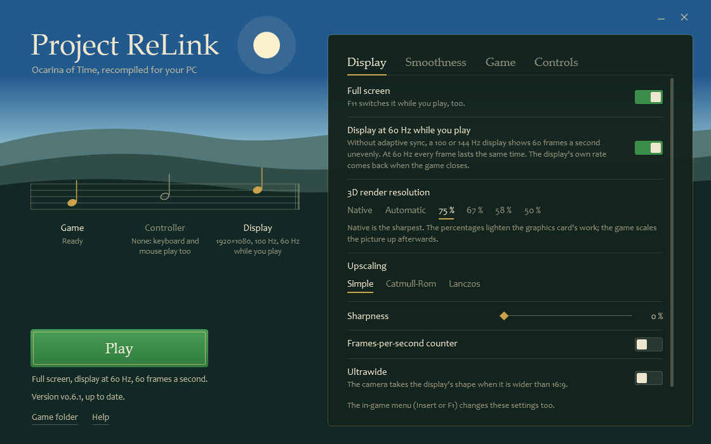
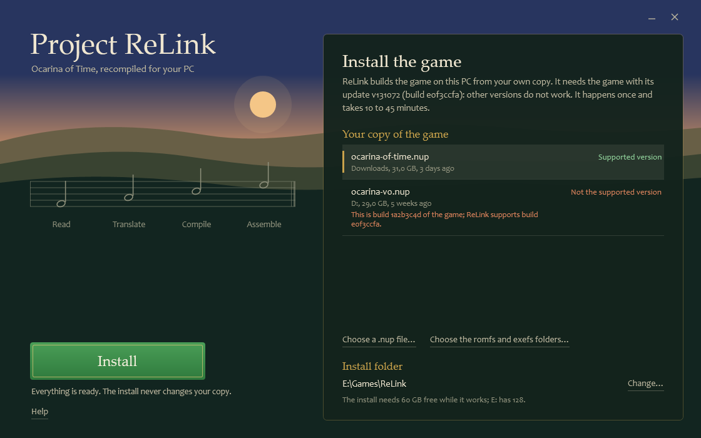
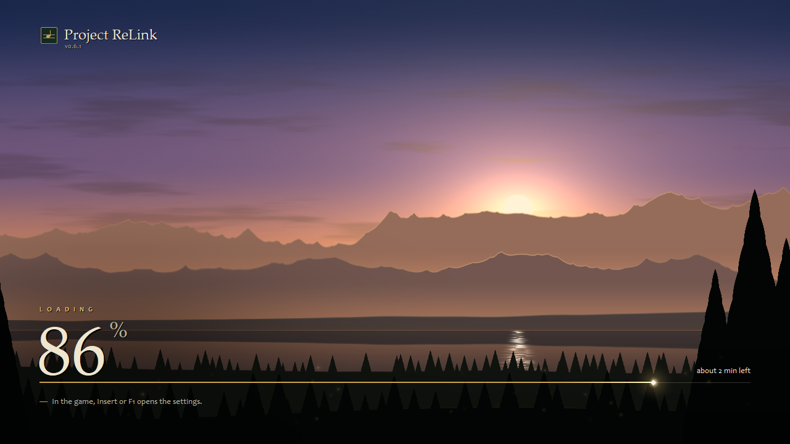

# Project ReLink

<a href="https://recomplauncher.com"><picture><source media="(prefers-color-scheme: dark)" srcset="https://recomplauncher.com/assets/press/launcher/badge-light.svg"></picture></a>

**Zelda OOT Remake Recomp.** An unofficial static recompilation of *The Legend of Zelda: Ocarina of Time* (the Switch 2
remake) into a native Windows game: the game's code is translated to PC code and compiled on your machine, with no emulator.

[Français plus bas](#français)



**No game files are in this repository.** ReLink builds the game on your PC from your own copy.

## The game version you need

ReLink works with **one version of the game**: the Switch 2 remake with its update installed.

| | |
|---|---|
| Program | `0400486024DEC000` |
| Update | v131072 |
| Build | `e0f3ccfa` |

Other versions do not work: the launcher checks your copy and says so before it installs anything. Your copy is either a
`.nup` file, or the game's `romfs` and `exefs` folders.

## Install and play

1. Download `ReLink-Setup.exe` from the [latest release](https://github.com/pixl27/ProjectReLink/releases/latest).
2. Run it. It downloads ReLink and its tools (about 310 MB), checks them and opens the launcher. Nothing else to install:
   ReLink brings its own compiler and Python.
3. Pick your copy of the game. The launcher looks for `.nup` files in Downloads, Desktop and Documents; you can also choose
   one, drop it on the window, or give the `romfs` and `exefs` folders.
4. Press **Install**. It takes 10 to 45 minutes depending on your CPU; you can keep using the PC.
5. Press **Play**. The desktop and Start menu shortcuts open the launcher from then on.

**With RecompLauncher.** Each release also has `ProjectReLink-<version>-Windows-x64.zip`, the same tools in one file, with a
`recomplauncher.json` that lets [RecompLauncher](https://recomplauncher.com) install ReLink, ask for your copy (the same
version as above), build the game in the same way and start it. Its settings page writes the game's own
`relink_options.ini`; the frame rate goes in `relink_env.txt` beside it.

The first start is long, once (about 16 minutes on our PC): the game prepares its shaders and builds its graphics pipelines
for your driver's cache, with a progress screen. It does that part again after a graphics driver update, so that the first
visit of a place does not stutter while the driver compiles, and after an update of ReLink that changes the renderer's
shader code or state (0.6.3 is one).





### What your PC needs

- 64-bit Windows 10 or 11, and a CPU with AVX2.
- A graphics card with Vulkan 1.3 and mesh shaders, with an up-to-date driver: NVIDIA GeForce RTX 20 series or newer, AMD
  Radeon RX 6000 series or newer, Intel Arc. We only tested on NVIDIA.
- 8 GB of video memory recommended, 16 GB of RAM or more.
- About 60 GB free while it installs, and an internet connection for the download.

### Updating

The launcher says when a new release is out. **Update** downloads only what changed and builds the game again in the same
folder, from the game files the folder keeps: your `.nup` is not needed again. Saves (`user`), settings and mods are kept.

### Where the files go

- The game: the folder you choose (`Games\ReLink` in your user folder by default). Your copy is never changed.
- ReLink itself: `%LOCALAPPDATA%\ReLink`. The build files (about 4 GB) are deleted once the game is ready.
- To uninstall: delete the game folder, `%LOCALAPPDATA%\ReLink` and the shortcuts.

## Settings

The launcher sets the display (full screen, 3D render resolution, upscaling, sharpness, ultrawide), the smoothness (60
frames a second or unlocked, frame generation), the game's language and the controls. It can put the display at 60 Hz while
you play, so that every frame lasts the same time on a 100 or 144 Hz display, and puts the display's own rate back
afterwards. In the game, **Insert** or **F1** opens the same menu, and **F11** switches full screen.

The launcher is in English; French is one click away on its Game page. An Xbox controller or any XInput controller works,
and so do keyboard and mouse (the keys are listed on the Controls page). Since 0.6.2 the install also brings SDL, which the
game uses for the other controllers (Switch Pro, DualSense, DualShock 4): 0.6.1 shipped without it and they did nothing in
the game. We have none of them here, so that part is not tested by us.

The mouse turns the camera after a click in the game's window (Escape frees it). The Insert menu's **Mouse camera** row
chooses how: as the right stick, or "Native", one to one as in a PC game. If the game has no sound, the same menu's
**Audio output** row (Gameplay) can be set to Stereo; it applies after a restart.

## Measured frame rates

On our PC: **Ryzen 5 5500, GeForce RTX 3060 Ti (8 GB), 16 GB of RAM, Windows 11**.

**No DLSS, no frame generation.** Every number here counts frames the game really rendered: no AI upscaler and no
generated frames were on. The game was capped at 60 frames a second; version 0.6.1, built by the release's own tools as
on a player's PC. "Native" is the game's 3D render resolution at 100 %; at 75 % the game's own plain scaling fills the
window. Each figure is one run of about 50 seconds with child Link, from his arrival in the place and through a walk, so
it includes the loading stall of the arrival.

| Place | Native (100 %) | 75 % |
|---|---|---|
| Hyrule Field | 59.6 | 59.9 |
| Kakariko Village | 59.0 | 59.0 |
| Hyrule Castle | 58.2 | 59.2 |
| Lost Woods | 58.5 | 59.6 |
| Sacred Forest Meadow | 60.0 | 60.0 |
| Lake Hylia | 58.0 | 58.7 |
| Zora's Fountain | 56.7 | 58.4 |
| Market | 54.0 | 55.6 |
| Inside the Deku Tree | 59.8 | 59.9 |
| Dodongo's Cavern | 60.0 | 59.9 |
| Inside Jabu-Jabu's Belly | 59.9 | 59.9 |
| Bottom of the Well | 60.0 | 60.0 |

At native resolution the heaviest views of Kokiri Forest's village run at 55 to 56. With adult Link at 75 %, standing, an
earlier development build of this version gave 60 in Kakariko Village, the Fire Temple and Gerudo's Fortress and 58.0 in
the Water Temple; those four were not measured again on the release's build.

Version 0.6.2 translates the game with a play profile made in 30 places, child and adult Link, temples included (0.6.1's
came from 10, child only). The table above was not measured again with it. With the frame rate unlocked, at 75 %, in the
ten of these places whose walk has no loading screen, it gave about 3 % more frames while Link walks (four runs against
six of 0.6.1, the two versions run in turn: 69.0 to 71.1 against 66.1 to 69.1 as a geometric mean), most of it in the
dungeons (Inside the Deku Tree +11 %, Jabu-Jabu +5 to +8 %), and no difference we could establish with Link standing.

Version 0.6.3 gives the game's occlusion test its real answers. The game draws a box for each object in a depth-only
pass, asks the graphics card how many of its pixels passed, and leaves out of its next frames the objects that got none.
Until now every question was answered "visible", so nothing was ever left out. With the frame rate unlocked, at 75 %,
Link standing where he arrives, the same build run with the answers off and then on: Market 54.6 to 61.4 (+12.5 %), Lost
Woods 61.9 to 67.0 (+8.2 %), Kokiri Forest 76.1 to 79.4 (+4.4 %), and the most draws in a frame went from 2,931 to 2,494.
Two earlier pairs of runs gave the Market +12.3 % and +28.8 %, Lost Woods +7.0 %, Kokiri Forest +3.3 % and Hyrule Castle
no change. Kakariko Village gave +2.6 % and +13.8 %: that place varies by several frames from one run to the next, so
neither figure says much. The table above was not measured again. The pictures were compared standing in four places, and
turning and walking in the Market and inside the Deku Tree: nothing was missing. An object that appears one frame late
was not looked for frame by frame; `RX_VK_OCC_QUERIES=0` in `relink_env.txt` beside the game turns the real answers off.

Not reached or not measured yet: a steady 60 everywhere (the Market stays below, and so do a few places at native
resolution), boss fights, sessions longer than half an hour, and AMD and Intel cards.

## If the game slows down with adult Link: check your dump

Some dumps hold a few damaged textures. The game then loads the model that needs one again and again for ever, which keeps
more than one CPU core busy as soon as Link is an adult. Two tools in this repository deal with it, from your own files
(nothing of the game is in them):

```powershell
python -I tools/dump_check.py "C:\Games\ReLink\romfs\Tex"
python -I tools/dump_repair.py "C:\Games\ReLink\romfs" "C:\Games\ReLink\mods\00-dump-repair"
```

The first counts the damaged files; the second writes a small mod that stands in for the ones it knows with an intact
texture of the same family. They need the `zstandard` package, which ReLink's own Python has
(`%LOCALAPPDATA%\ReLink\versions\<version>\ReLink\tools\python\python.exe`).

## Mods

RomFS mods go in `mods\<name>\romfs\...` in the game folder, with the same paths as the game's. The log
(`relink_log.txt`) names each mod it reads. Patches of the game's code (`exefs`) are not supported: the code is compiled
ahead of time.

## Build from source

For developers. The launcher runs the same script, `nx2/make_game.py`.

```powershell
python -I nx2/make_game.py --nup "C:\path\your-game.nup" --out "C:\Games\ReLink" --language en-US
python -I nx2/make_game.py --romfs "C:\path\romfs" --exefs "C:\path\exefs" --out "C:\Games\ReLink" --language en-US
```

`--game <path>` takes either one (a `.nup`, or a folder holding `exefs` and `romfs`) in place of those options.
`--check` with your `.nup` only checks the game's version. `--log file` keeps the output. `RELINK_JOBS=<n>` limits how many
files compile at once.

You need:

- Python 3 from python.org, with `pip install lz4 numpy capstone "unicorn>=2.1,<2.2" zstandard`.
- [llvm-mingw](https://github.com/mstorsjo/llvm-mingw) (the `ucrt-x86_64` build), unpacked as `llvm-mingw` in the clone, or
  `RELINK_MINGW` set to its folder.
- The Vulkan headers and FFmpeg in the CPM cache's layout, with `RX_CPM` set to their folder. Without them the Vulkan
  renderer is not built.
- The prebuilt files of `third_party` and the play profile of `work`. An installed ReLink holds them, in
  `%LOCALAPPDATA%\ReLink\versions\<version>\ReLink\tools`.

The launcher is in `launcher/` (`dotnet build`, .NET 9), the small setup in `launcher/setup/`. Publishing a release is
described in [docs/releasing.md](docs/releasing.md).

### How it works

1. `nx2/lift.py` translates the game's ARM64 code to C.
2. `nx2/build.py` compiles that C together with `host/`, which plays the part of the console's system.
3. `host/nvn_native.c` records the game's graphics calls, and `gpu/vk/` replays them on Vulkan.

## License

Project ReLink is free software under the [GNU General Public License, version 3 or later](LICENSE) (GPL-3.0-or-later). It
reuses and modifies code published under the GPL by other projects (modified in November 2026); each part keeps its
copyright notices and licenses in its files and folders.

Project ReLink is an unofficial fan project, not affiliated with or endorsed by Nintendo. The Legend of Zelda and Ocarina
of Time are trademarks of Nintendo.

---

## Français

**Project ReLink** est une recompilation statique, non officielle, de *The Legend of Zelda: Ocarina of Time* (le remake
Switch 2) en jeu Windows natif : le code du jeu est traduit en code PC et compilé sur votre machine, sans émulateur.
**Ce dépôt ne contient aucun fichier du jeu** : ReLink fabrique le jeu sur votre PC à partir de votre propre copie.

### La version du jeu qu'il vous faut

Une seule version fonctionne : le remake Switch 2 avec sa mise à jour installée (programme `0400486024DEC000`, mise à jour
v131072, build `e0f3ccfa`), en fichier `.nup` ou en dossiers `romfs` et `exefs`. Le lanceur vérifie votre copie avant
d'installer quoi que ce soit.

### Installer et jouer

1. Téléchargez `ReLink-Setup.exe` dans la [dernière version](https://github.com/pixl27/ProjectReLink/releases/latest).
2. Lancez-le. Il télécharge ReLink et ses outils (environ 310 Mo), les vérifie et ouvre le lanceur. Rien d'autre à installer.
3. Choisissez votre copie du jeu : le lanceur cherche les `.nup` dans Téléchargements, Bureau et Documents ; vous pouvez aussi
   en choisir un, le déposer sur la fenêtre, ou donner les dossiers `romfs` et `exefs`.
4. Appuyez sur **Install**. Comptez 10 à 45 minutes selon le processeur ; le PC reste utilisable.
5. Appuyez sur **Play**. Le lanceur est en anglais par défaut ; le français se choisit dans sa page Game.

Il faut Windows 10 ou 11 en 64 bits, un processeur avec AVX2, une carte graphique avec Vulkan 1.3 et les mesh shaders
(GeForce RTX 20 ou plus récente, Radeon RX 6000 ou plus récente, Intel Arc ; nous n'avons testé que sur NVIDIA), 16 Go de RAM
et environ 60 Go libres pendant l'installation.

Le lanceur dit quand une nouvelle version est sortie ; **Update** ne télécharge que ce qui a changé et reconstruit le jeu sur
place. Les sauvegardes, les réglages et les mods sont conservés.

### Images par seconde mesurées

Sans DLSS et sans génération d'images : chaque image comptée est réellement calculée par le jeu. Sur un Ryzen 5 5500, une
GeForce RTX 3060 Ti (8 Go), 16 Go de RAM et Windows 11, jeu limité à 60 images par seconde. En résolution native (rendu 3D à
100 %) : 57 à 60 dans la plupart des lieux (plaine d'Hyrule 59,6, village Cocorico 59,0, château d'Hyrule 58,2, lac Hylia
58,0, fontaine Zora 56,7, donjons 60) et 54,0 sur la place du marché. Avec le rendu 3D à 75 % : 58 à 60 partout sauf sur
la place du marché (55,6). Ces chiffres sont ceux du jeu construit par les outils de la version, comme chez un joueur. Le
60 constant partout n'est pas encore atteint, et les combats de boss, les longues sessions et les cartes AMD et Intel
n'ont pas été mesurés. Le tableau complet, lieu par lieu et aux deux résolutions, est dans la partie anglaise.

La version 0.6.3 rend au jeu son test d'occlusion : il ne dessine plus les objets que la carte graphique dit cachés. À
cadence libre, rendu 3D à 75 %, Link immobile, le même build avec et sans : place du marché 54,6 → 61,4 (+12,5 %), Bois
perdus +8,2 %, forêt Kokiri +4,4 %. Le tableau ci-dessus n'a pas été mesuré de nouveau. Le premier démarrage après cette
mise à jour prépare les shaders une nouvelle fois.

### Licence

GPL-3.0-or-later ([LICENSE](LICENSE)). Le projet reprend et modifie du code publié sous GPL par d'autres projets
(modifications de novembre 2026) ; chaque partie garde ses mentions de droits d'auteur et ses licences dans ses fichiers.
Projet de fans non officiel, sans lien avec Nintendo ; The Legend of Zelda et Ocarina of Time sont des marques de Nintendo.
