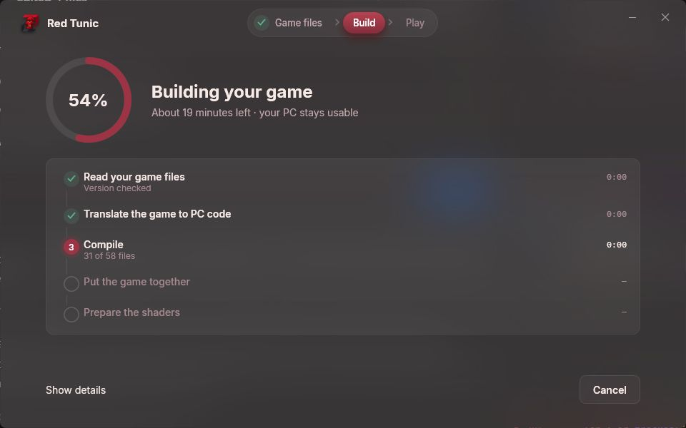
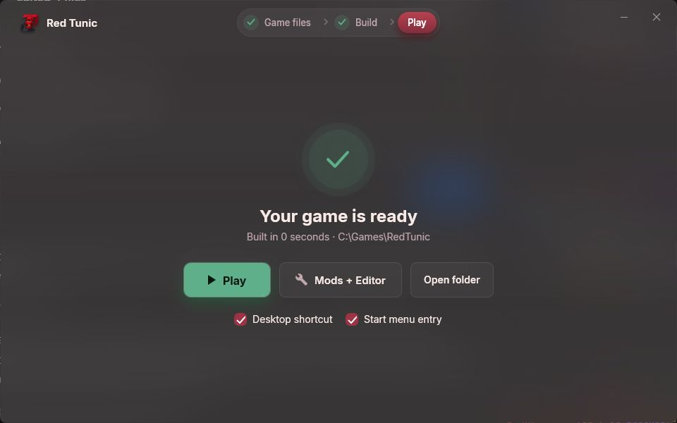

# Getting started

Red Tunic Builder creates a playable installation on your computer from your own supported copy of the game.
**We do not host, store, or distribute game files, ROMs, game dumps, or decryption keys.**

## Before you begin

Read the README's [current requirements](../readme.md#install-and-play) for the supported game version, operating
system, GPU capabilities, memory, and free space. The builder checks your game version before building.

## Windows

Get the builder from the [official releases](https://github.com/spacefarergames/RedTunic/releases/latest), then follow the
[Windows installation steps](../readme.md#on-windows). That section covers choosing your game, installation folder,
and language, building, and launching.

## Linux and SteamOS

Follow the [Linux build instructions](../readme.md#on-linux) to build and launch from source.
Use the README for the current distribution and CPU requirements.

## Your first launch

See [the in-game menu](../readme.md#in-game-menu) for settings and controls. For a failed build or a problem in game,
start with [Common issues](common-issues.md) and [the README's troubleshooting section](../readme.md#if-something-goes-wrong).

## Windows Builder screens

The Builder previews below use example progress and an example install path.

